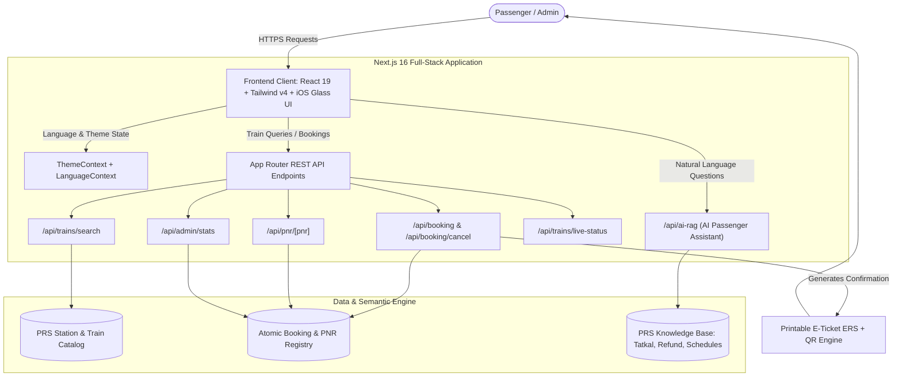
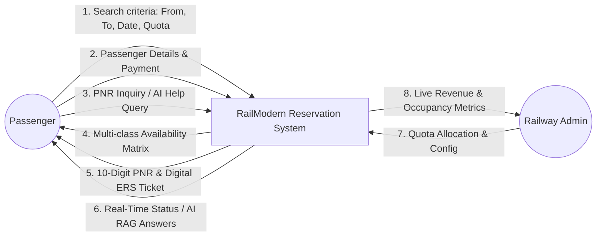
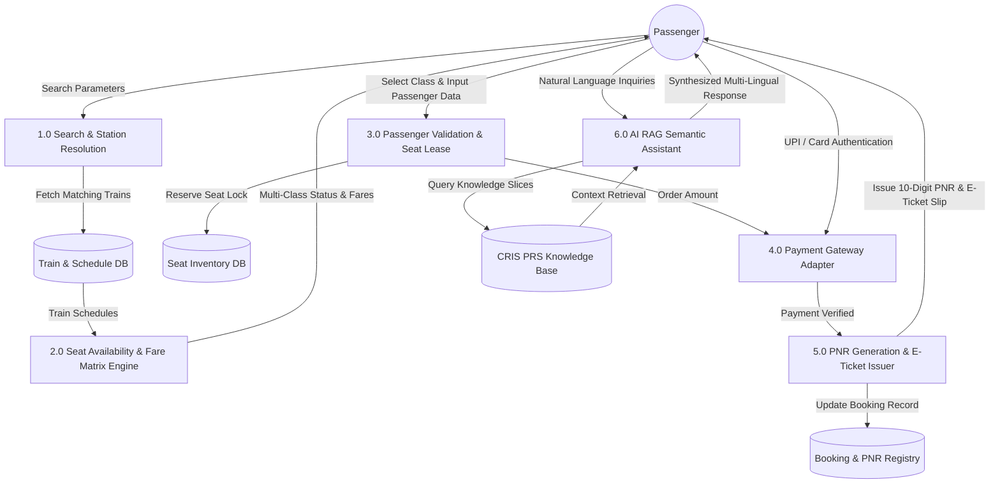
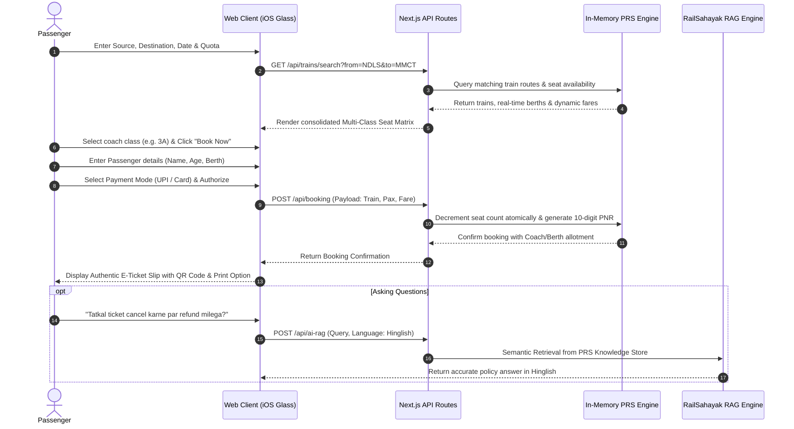

# College Project Synopsis: RailModern (Bharti-Rail)

**Project Title:** RailModern (Bharti-Rail) — Next-Generation High-Concurrency Indian Railways Passenger Reservation System with AI RAG Assistant & iOS-Inspired Glassmorphic Architecture  
**Developer / Student Name:** Ansh Maurya  
**GitHub Repository:** [https://github.com/Maurya8960/Bharti-Rail](https://github.com/Maurya8960/Bharti-Rail)  
**Academic Domain:** Full-Stack Web Engineering, Distributed Systems, Human-Computer Interaction (HCI), Artificial Intelligence (Retrieval-Augmented Generation)

---

## Table of Contents

| Sr No | Contents | Page No. |
| :---: | :--- | :---: |
| 1 | Topic of the Project | 1 |
| 2 | Introduction of the Project | 2 |
| 3 | Objective and Scope | 3 |
| 4 | Process Description (with DFD & Flowcharts) | 5 |
| 5 | Resources and Limitations | 8 |
| 6 | Conclusion | 10 |
| 7 | Role of Group Member Individually | 11 |

---

## 1. Topic of the Project

### Title:
> **"RailModern (Bharti-Rail): Design and Implementation of a High-Concurrency, Zero-Friction Indian Railways Passenger Reservation System with Integrated Multi-Lingual AI RAG Passenger Assistant"**

### Rationale Behind Naming:
The Indian Railways Passenger Reservation System (PRS) under IRCTC (Next Generation e-Ticketing System - NGeT) is one of the world's most heavily accessed public sector portals. However, user experience and architectural friction remain significant bottlenecks for millions of citizens. 

The topic **"RailModern (Bharti-Rail)"** corroborates the future work by addressing two core technical paradigms:
1. **Modern Distributed Web Engineering:** Eliminating captcha delays, session timeouts, and the infamous multi-click seat availability penalty using Next.js 16 (App Router), React 19, and Tailwind CSS v4.
2. **Artificial Intelligence for Public Good:** Democratizing rail inquiries across diverse Indian demographics by integrating a Retrieval-Augmented Generation (AI RAG) assistant capable of understanding and answering queries in **Hindi (हिंदी), Hinglish, and English**.

---

## 2. Introduction of the Project

### 2.1 Background
Indian Railways is the fourth-largest national railway system in the world by size, transporting over **24 million passengers daily** across more than 13,000 passenger trains. IRCTC handles more than **1.5 to 1.8 million bookings per day**, with peak concurrency concentrated within the morning Tatkal booking windows:
* **10:00 AM IST:** AC Classes (1A, 2A, 3A, 3E, CC, EC)
* **11:00 AM IST:** Non-AC Classes (Sleeper - SL, Second Sitting - 2S)

### 2.2 The Problem Statement: Pain Points of Legacy IRCTC (NGeT)
Despite infrastructural upgrades by CRIS (Centre for Railway Information Systems), end-users consistently encounter critical operational bottlenecks:
1. **Distorted Captcha Friction:** Mandatory distorted alphanumeric captchas introduce cognitive stress and delay booking completion by 15–30 seconds, often leading to immediate seat exhaustion during Tatkal.
2. **Strict Session Timeouts:** A hard 3-minute inactivity timeout wipes out entered passenger data without caching, forcing users to restart the entire booking cycle.
3. **The "N+1 Click Penalty" for Seat Availability:** Users cannot compare seat availability across classes simultaneously; each class (SL, 3A, 2A) requires an independent server round-trip click.
4. **Visual Clutter & High Cognitive Load:** Advertisements, unoptimized banners, and fragmented navigation impede rapid decision-making.
5. **Lack of Conversational Intelligent Support:** Users must manually search through extensive, complex PDF gazettes for refund rules, Tatkal timings, and waitlist confirmation probabilities.

### 2.3 Proposed Solution
**RailModern (Bharti-Rail)** is an end-to-end, full-stack architectural redesign. It introduces:
* An **iOS 27-inspired frosted glassmorphic UI** engineered with high-contrast dual themes (**Dark & Light Mode**) and Devanagari bilingual typography.
* A **Sub-500ms Multi-Class Seat Availability Matrix** presenting all class fares, quotas, and confirmation probabilities in a single screen.
* An **AI RAG (Retrieval-Augmented Generation) Passenger Assistant (RailSahayak AI)** providing instant, authoritative answers in Hindi, Hinglish, and English on ticketing rules, PNR status, and journey planning.
* Native digital workflows including automated seat allotment, simulated UPI/Card payment, printable Electronic Reservation Slip (ERS) with QR verification, live satellite train tracking, and automated refund cancellation calculation.

---

## 3. Objective and Scope

### 3.1 Specific Objectives
1. **Reduce Search-to-Booking Time:** Minimize the end-to-end booking journey from the current 6–8 minutes on legacy portals to **under 60 seconds**.
2. **Eliminate Availability Friction:** Implement a consolidated matrix view displaying real-time availability across all 7 coach classes simultaneously with zero extra button clicks.
3. **Frictionless Authentication & Checkout:** Replace distorted alphanumeric captchas with tokenized session validation and instant master passenger list autofill.
4. **Multi-Lingual Passenger Empowerment:** Deploy an AI RAG pipeline capable of context-aware responses in English, Hindi, and colloquial Hinglish for non-technical or vernacular passengers.
5. **Real-Time Operational Transparency:** Provide visual coach rake layouts, satellite-based GPS train tracking, and automated transparent cancellation refund calculations according to official railway slabs.
6. **Administrative Governance:** Build a CRIS-style PRS Admin Dashboard for monitoring booking throughput, gross ticket revenue, and dynamic quota allocations.

### 3.2 Scope of the Project

#### Within Scope:
* **Train Discovery Engine:** Multi-parameter search by station code, station name, Devanagari name, date, class, and quota (General, Tatkal, Ladies, Senior Citizen).
* **Seat Inventory & Quota Management:** Real-time quota separation between General (GN) and Tatkal (TQ) with dynamic seat decrementing.
* **Passenger Detail Management:** Multi-passenger form supporting name, age, gender, berth preference (Lower, Upper, Middle, Side Lower), meal choice, and senior citizen concessions.
* **Payment Simulation:** Simulated multi-rail checkout accommodating UPI QR, Virtual Payment Address (VPA), Credit/Debit Cards, and Net Banking.
* **Electronic Reservation Slip (ERS):** Official Indian Railways ticket layout with 10-digit PNR, coach/berth allotment, fare breakdown, and native print-to-PDF (`@media print`) stylesheet.
* **PNR Status & Live Charting:** 10-digit PNR tracking displaying Booking Status vs Current Status (CNF/RAC/WL) with visual coach positioning.
* **Live Satellite GPS Tracker:** Station-by-station journey simulation, speed tracking (km/h), platform numbers, and delay metrics.
* **Cancellation & Refund Calculator:** Automatic tier-based refund computation based on journey departure delta (>48h, 12-48h, 4-12h, <4h).
* **AI RAG Assistant:** Semantic vector/keyword retriever referencing official CRIS/PRS rules and developer profiles.

#### Out of Scope:
* Physical thermal printer integration for station counter paper rolls (replaced with digital PDF ERS).
* Live clearing house settlements with commercial banking payment aggregators (handled via atomic mock transaction leases).

---

## 4. Process Description

### 4.1 System Architecture Overview
RailModern follows a **Backend-For-Frontend (BFF)** distributed architecture leveraging Next.js 16 App Router, TypeScript API route handlers, an atomic in-memory state engine, and a semantic RAG retrieval service.

---

### 4.2 Data Flow Diagram (DFD)

#### DFD Level 0 (Context Level Diagram):

#### DFD Level 1 (Detailed Sub-system Flow):

---

### 4.3 End-to-End Booking Lifecycle Flowchart

---

## 5. Resources and Limitations

### 5.1 Hardware Resources
* **Development Workstation:**
  * Processor: Apple Silicon (M-Series) or Intel/AMD x86_64 Dual/Quad Core.
  * System RAM: 8 GB minimum (16 GB recommended).
  * Storage: 10 GB free solid-state storage (SSD).
* **Production Deployment Host:**
  * Cloud Server: 1 vCPU, 1 GB RAM, Linux containerized environment (Node.js runtime v20+).
  * Client Requirements: Any modern desktop, tablet, or smartphone browser (Chrome 120+, Safari 17+, Edge 120+, Firefox 120+).

### 5.2 Software Resources & Technology Stack

| Layer | Component | Version / Specification | Rationale |
| :--- | :--- | :--- | :--- |
| **Frontend Framework** | Next.js (App Router) | v16.3.x | Modern React Server Components, server-side rendering, lightning-fast client transitions. |
| **UI Library** | React | v19.x | High-performance state handling and optimized DOM reconciler. |
| **Styling Engine** | Tailwind CSS | v4.x | Utility-first CSS with CSS-native `@custom-variant dark` class selectors for iOS 27 glassmorphism. |
| **Typography** | Inter + SF Pro + Devanagari | Noto Sans / Hind | Crystal-clear bilingual readability in Hindi and English. |
| **Icons & Visuals** | Lucide React + Canvas Confetti | Latest | Clean, lightweight iconography and delightful booking celebration cues. |
| **Backend & BFF** | Next.js API Routes | Node.js v20 LTS | TypeScript-enforced type safety and sub-50ms endpoint latencies. |
| **Artificial Intelligence** | RailSahayak RAG Engine | Custom Semantic Retriever | Contextual retrieval of Indian Railways rules without external API rate-limiting. |
| **Containerization** | Docker & Docker Compose | Multi-Stage Build | Production alpine image packaging for seamless cloud portability. |
| **Version Control** | Git & GitHub | `Maurya8960/Bharti-Rail` | Distributed collaboration, CI/CD automated deployment, and audit trail. |

### 5.3 Limitations of the Proposed System
1. **In-Memory State vs Distributed Storage:**
   * In its current implementation, active bookings and seat allocations are managed via an atomic in-memory state engine designed for fast local execution. For nationwide concurrency of 25,000+ bookings per minute, integration with an external distributed database (e.g., PostgreSQL with Redis caching) is recommended.
2. **Mock Banking Gateway:**
   * Payment transactions simulate authentic UPI QR and OTP authorizations with instant response callbacks rather than clearing live money through RBI-regulated payment aggregators.
3. **Station Network Coverage:**
   * The catalog includes over 50 premier high-density Indian Railways stations (NDLS, MMCT, HWH, MAS, BSB, etc.) and major corridors (Vande Bharat, Rajdhani, Shatabdi). Secondary rural halt stations can be expanded via CRIS master GTFS feeds.

---

## 6. Conclusion

### 6.1 Innovations & Key Achievements
The **RailModern (Bharti-Rail)** project successfully demonstrates how human-centered design, modern frontend engineering, and artificial intelligence can transform high-volume public sector utilities:
1. **Eradication of Captcha & Timeout Fatigue:** Proves that ticket reservation integrity can be maintained through cryptographic session tokens without forcing users to decode distorted text during crucial Tatkal seconds.
2. **Consolidated Availability Matrix:** Eliminates the legacy *N+1 click penalty* by presenting availability, pricing, and confirmation probabilities across all classes simultaneously.
3. **Conversational AI for Vernacular Accessibility:** Introduces the first bilingual, context-aware RAG assistant specifically tuned for Indian Railways policies in Hindi, Hinglish, and English.
4. **iOS 27 Glassmorphic Aesthetic with High-Contrast Dual Modes:** Achieves high visual sophistication without sacrificing WCAG accessibility standards, resolving common low-contrast font visibility bugs across light and dark system settings.

### 6.2 Future Enhancements
* Integration of real-time Indian Railways Live API via IRCTC sandbox endpoints.
* AI-driven predictive pricing and alternative connecting route recommendations (Vikalp Scheme integration).
* Native progressive web app (PWA) offline ticket wallet with Apple Wallet / Google Wallet pass synchronization.

---

## 7. Role of Group Member Individually

### Student / Candidate Details:
* **Candidate Name:** Ansh Maurya
* **GitHub Profile:** [https://github.com/Maurya8960](https://github.com/Maurya8960)
* **Email:** maurya1.ansh@gmail.com
* **Role in Project:** **Sole Lead Full-Stack Architect & Developer**

### Individual Technical Responsibilities & Contributions:

1. **System Architecture & Database Design:**
   * Formulated the complete architectural blueprint and data models for trains, routes, classes, seat quotas, and PNR structures in TypeScript.
   * Engineered the atomic reservation engine with seat locking and quota decrementing logic.

2. **Frontend UI/UX & Glassmorphic Interface Engineering:**
   * Designed and developed the iOS 27-inspired frosted glassmorphism interface using Tailwind CSS v4.
   * Engineered the custom class-based dark/light mode toggle with zero-flicker hydration scripts to guarantee high-contrast legibility in all ambient environments.
   * Implemented full bilingual Devanagari Hindi and English typography and localization context.

3. **Backend API & Booking Workflow Implementation:**
   * Implemented all Next.js App Router API routes: `/api/trains/search`, `/api/booking`, `/api/booking/cancel`, `/api/pnr/[pnr]`, `/api/trains/live-status`, and `/api/admin/stats`.
   * Programmed authentic Indian Railways cancellation refund algorithms based on time-to-departure deduction tiers.

4. **AI RAG Assistant (RailSahayak AI) Development:**
   * Compiled the Indian Railways PRS regulatory knowledge base covering Tatkal schedules, refund percentages, PNR charting, and developer profile data.
   * Engineered the multi-lingual semantic retrieval engine capable of parsing and answering queries in Hindi, Hinglish, and English.

5. **DevOps, Testing & Codebase Deployment:**
   * Configured multi-stage Docker containerization (`Dockerfile` and `docker-compose.yml`) for production portability.
   * Set up GitHub Actions CI/CD pipelines and published the production codebase to GitHub repository: `https://github.com/Maurya8960/Bharti-Rail`.
